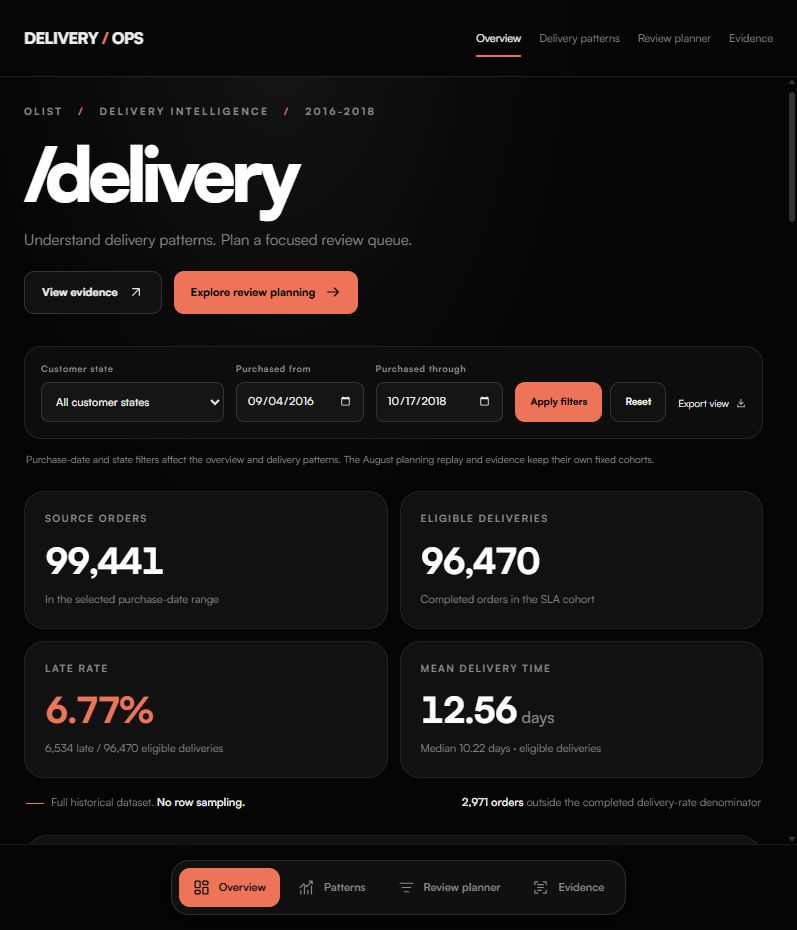

# Delivery Ops

**E-commerce Delivery Risk & Operations Planning**

Explore why deliveries arrive late, compare approval-time risk models, and allocate a limited operations review queue. This project combines SQL engineering, statistical analysis, machine learning, constrained optimization, Excel, Power BI and a working web dashboard using historical Olist data.



**[Open the live dashboard](https://delivery-ops-mk.vercel.app/)** — Vercel hosts the frontend and Render hosts the Python API. A matching connection screen stays visible while the analysis server starts, with real elapsed time, bounded retries and an offline fallback. No Azure or Databricks account is needed to use it. See the [hosting guide](docs/HOSTING_GUIDE.md).

## Try the dashboard

Use **Python 3.13**. From this repository on Windows:

```powershell
python -m venv .venv
.\.venv\Scripts\Activate.ps1
python -m pip install -r requirements.txt
python run_delivery_dashboard.py --check
python run_delivery_dashboard.py
```

Open **http://127.0.0.1:8125**. On macOS/Linux, activate with `source .venv/bin/activate`; the remaining commands are the same. On a configured Windows environment, `START_Delivery_Dashboard.cmd` opens the app and `STOP_Delivery_Dashboard.cmd` stops its owned background instance.

The prebuilt, hash-checked serving snapshot includes **all 99,441 orders**, frozen model ranks and saved planning scenarios. Starting the app does not download the raw dataset, train a model, contact a cloud account or execute delivery actions.

- Filter purchase dates and customer states; inspect monthly counts/rates and delivery comparisons.
- Export the currently applied overview as CSV.
- Compare four policies across seven saved capacity/time scenarios and 28 screening batches.
- Change the time, review-count and seller limits for one historical batch; run the actual bounded SciPy/HiGHS optimizer.
- Inspect model/statistical evidence and download the native Excel and Power BI files.
- Use either navigation menu; both follow the visible section while scrolling.

## Results and boundaries

| Measure | Result |
|---|---:|
| Original CSV files / source rows | 9 / 1,550,922 |
| Orders retained | 99,441 |
| Eligible completed deliveries | 96,470 |
| Late deliveries | 6,534 (6.77%) |
| Outside the completed-outcome denominator | 2,971 |
| Clean Parquet exports / SQL business analyses | 8 / 12 |
| Selected ranker | Static-feature logistic regression, 31 inputs |
| Mature orders used in the final refit | 83,848 |
| Reused-August average precision / constant baseline | 0.0901 / 0.0625 |
| Default optimized queue across 28 batches | 721 reviews, 3,314 minutes |
| Known late / unknown outcomes within that queue | 79 / 24 |

An estimated delivery date covers the entire calendar day. A midnight-timestamp comparison would incorrectly add **1,292** late labels. Unknown outcomes remain unknown.

The first independent August model test failed. The updated model uses forward validation but reuses an already inspected August period for diagnosis. Its ranking improvement is modest and absolute probability reliability is not established. Four month-adjusted statistical contrasts are exploratory associations, with purchase-week clustered uncertainty and Holm-adjusted p values. They are not causal effects.

Planning maximizes **ordinal model priority**, under equal time, review-count and primary-seller limits for each policy. Review durations are illustrative. Known late counts are joined after selection; they are not prevented delays, proven savings or production performance. See the [model card](docs/MODEL_CARD.md), [feature contract](docs/FEATURE_CONTRACT.md) and [operations results](docs/OPERATIONS_RESULTS.md).

## Native reporting

| Artifact | What is included |
|---|---|
| [Excel workbook](reports/native/Delivery_Operations.xlsx) | Five sheets, formulas/SUMIFS summaries, three editable charts, scenario selectors and six reconciliation controls |
| [Power BI report](reports/native/Ecommerce_Delivery_Operations.pbix) | Four native pages, eight imported tables, five relationships, 30 DAX measures and 52 visual elements |
| [Editable Power BI project](powerbi/project/Delivery.pbip) | PBIP/PBIR/TMDL source with embedded snapshot queries |

Download the native files using GitHub's **Download raw file** control and open them in Excel or Power BI Desktop. The PBIX already contains its loaded model. The PBIP's first opening may require **Refresh**. Both reports are portable snapshots, without a live cloud connection. Excel reads saved optimizer results and uses formula summaries; native PivotTables are not claimed.

The [reporting guide](docs/REPORTING_GUIDE.md) records how the reports were checked. The Excel authoring source needs the Codex-bundled `@oai/artifact-tool`, which is not included in pip dependencies; opening the completed workbook does not need that authoring tool. Native Power BI engine checks need a running Desktop instance and the Microsoft client libraries described in [powerbi/README.md](powerbi/README.md).

## How the data moves

```text
Original Olist CSVs
  ├─ Local DuckDB → typed SQL tables → order/item/seller marts → Parquet + analyses
  │                 ├─ approval-time features → forward validation → frozen ranks
  │                 ├─ clustered statistical comparisons
  │                 └─ constrained review planning → reports + serving snapshot
  └─ Azure landing → Data Factory → Azure bronze
                                     ↓ hash-verified local handoff
                     Databricks Free Edition → bronze Delta → silver SLA → gold overview

Serving snapshot → FastAPI + HTML/CSS/JavaScript dashboard
Reporting snapshots → Excel + Power BI
```

The Azure/Databricks path was actually executed and independently reconciled. Standalone **Databricks Free Edition** was used, rather than native Data Factory-to-Azure-Databricks notebook orchestration. Training, statistics and review optimization ran on the local CPU. The app uses a read-only DuckDB serving file, not a live cloud refresh. Custom inputs/results stay in memory and no new-dataset upload endpoint exists.

Cloud scripts are available for inspection, but are not run by app startup or CI. The published Azure budget approval is deliberately **false**. Reproduction needs your own account configuration, fresh cost review and approval. Historical verification records are dated observations, not current billing or warehouse-status claims. See [Azure](azure/README.md), [Databricks](databricks/README.md) and [cloud evidence](docs/CLOUD_VERIFICATION.json).

## Reproduce the analysis

Original CSVs and the larger working/training databases are excluded from Git. The dataset downloader pins **version 2** and verifies every source hash:

```powershell
python scripts/download_dataset.py
python delivery_pipeline.py
python -m pytest tests -q
```

If Kaggle requests access, obtain version 2 from the [original dataset page](https://www.kaggle.com/datasets/olistbr/brazilian-ecommerce) and run `python scripts/download_dataset.py --source <folder-containing-the-nine-CSVs>`.

The 99 Python tests check source reconciliations, date definitions, temporal leakage, statistical uncertainty, solver constraints, API boundaries and actual report downloads. Another 13 frontend tests check startup, timeouts, cancellation, recovery and offline behavior (`node --test tests/connection.test.cjs`). GitHub Actions uses the same versioned public source, rebuilds the SQL foundation and runs both suites; it performs no cloud-resource creation, model training or deployment.

To rerun the modeling and planning stages after preparing the foundation:

```powershell
python train_delivery_model.py prepare
$featureRun = (Get-Content reports/modeling/latest_prepared.json -Raw | ConvertFrom-Json).run_id
python audit_delivery_history.py --run-id $featureRun
python train_delivery_rolling.py --feature-run $featureRun
python run_delivery_operations.py
python verify_delivery_operations.py
python reporting_data.py
python build_dashboard_data.py
```

Reruns create new versioned results. They do not create an independent new-period test. The original failed prototype and selected model are retained in `models/`, with dated evaluation outputs in `reports/modeling/`.

## Repository map

| Folder/file | Purpose |
|---|---|
| `sql/`, `delivery_pipeline.py` | Cleaning, preserved grains, reconciliations and business queries |
| `delivery_features.py`, `delivery_risk.py`, `train_delivery_*.py` | Decision-time feature contract and model experiments |
| `delivery_statistics.py`, `delivery_planner.py` | Clustered contrasts and equally constrained review allocation |
| `azure/`, `databricks/` | Optional, guarded cloud ingestion and independent verification |
| `dashboard/`, `delivery_dashboard.py` | Approved Midnight Editorial UI and bounded read-only API |
| `data/dashboard/` | Prebuilt serving data and SHA-256 provenance |
| `excel/`, `powerbi/`, `reports/native/` | Authoring source and completed native reports |
| `tests/`, `.github/workflows/` | Automated verification and CI, without deployment |
| `docs/`, `reports/` | Dated model/operations/report evidence and usage guides |

Original execution evidence preserves historical source hashes. Publication makes native-download and authoring-output paths repository-local; [publication checks](docs/PUBLICATION_VERIFICATION.json) separately record the published tree's validation. Account identifiers, credentials, local account caches, desktop model caches and raw cloud responses are excluded.

## Data attribution

[Brazilian E-Commerce Public Dataset by Olist](https://www.kaggle.com/datasets/olistbr/brazilian-ecommerce), version 2, by Olist and collaborators. Kaggle lists **CC BY-NC-SA 4.0**. Cleaning, labels, model outputs and report snapshots are modifications/derivatives for this noncommercial educational portfolio. Olist does not endorse the project. See [data provenance](data/README.md) and [third-party notices](THIRD_PARTY_NOTICES.md) for attribution and applicable terms.
